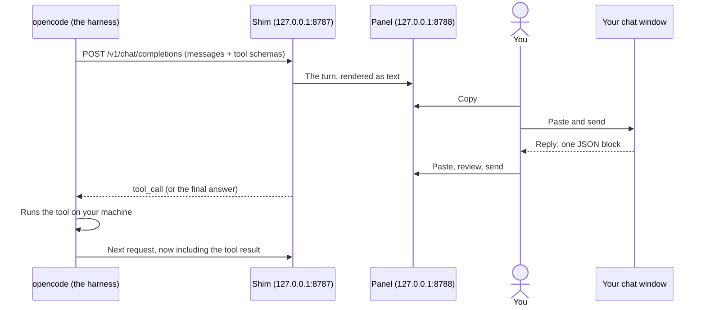

# How a Coding Harness Works

An educational project that puts **you** between a coding agent and the model it talks to, so you
can see every message the harness sends and every tool call that comes back.

It runs [opencode](https://opencode.ai), an open-source coding agent, against an ordinary LLM chat
window such as Microsoft 365 Copilot. A small local server (the **shim**) stands where the model's
API would normally be. Each turn shows up in a browser panel; you copy it into your chat window,
then paste the model's reply back. Nothing reaches opencode until you have read it and pressed
**Send**.

The result is a slow, hands-on view of the agentic loop: the system prompt, the tool definitions,
the model's tool calls, the tool results, and the final answer, one step at a time.

> [!CAUTION]
> **Automating the copying and pasting could break the terms and conditions of the chat service you
> use, and is advised against.** Many LLM chat services prohibit scripted, automated or bot access to
> their chat interface. If you are unsure what your service allows, consult a lawyer and/or the
> provider of the LLM chat interface you are using for clarity.
>
> **Recommended:** to stay compliant with terms and conditions, use only your own chat interface,
> with your own account, and do every copy and paste yourself, by hand.

## What you will learn

- **The model never touches your machine.** It only writes text that *describes* a tool call. The
  harness (opencode) runs the tool on your computer and sends back the result.
- **Tools are just JSON Schemas.** Every request carries a list of tools (`bash`, `read`, `edit`,
  `write`, `glob`, `grep`, `webfetch`, `todowrite`, `task` and a few more, depending on your opencode
  version) with a description and a parameter schema for each. You will see all of them in the
  first turn.
- **The loop.** Request, tool call, tool result, request again, until the model gives a final
  answer. A simple question like "how many lines are in this file?" takes two turns: one tool call,
  then the answer.
- **The system prompt.** You will see what opencode tells the model about how to behave: its tool
  usage policy, how to do tasks, code conventions and so on.
- **Housekeeping calls.** Not every model call is part of the loop. opencode also asks the model to
  generate a session title. Those requests carry no tools, which is how the shim spots them and
  answers them itself.
- **State lives in the harness.** The API is stateless, so opencode resends the whole conversation
  on every turn. The shim keeps its own transcript and only gives you the *new* part to paste,
  because your chat window already remembers the rest.
- **Tool calling without native tool calling.** A chat window cannot return structured tool calls,
  so the shim asks the model to reply with a single JSON block and parses it. That is roughly what a
  provider's tool-calling feature does for you behind the scenes.

## How it works



The model is asked to reply in exactly one of two shapes:

```json
{"type":"tool_call","name":"bash","arguments":{"command":"wc -l src/protocol.mjs","description":"count lines"}}
```

```json
{"type":"final","content":"src/protocol.mjs is about 460 lines long."}
```

The shim turns the first into a real OpenAI-style `tool_calls` response, which opencode executes.
The second ends the loop.

## Quick start

You need Node.js 22 and an account with an LLM chat service.

```bash
git clone https://github.com/Erik-Koning/How-A-Coding-Harness-Works-Educational.git
cd How-A-Coding-Harness-Works-Educational
npm install          # also builds the shim and the panel
npm start            # starts the shim; leave this running
```

In a second terminal, from the same folder:

```bash
npx opencode run "How many lines are in src/protocol.mjs?"
```

The panel opens in your browser. Follow the banner at the top of it.

**For the full walkthrough, configuration and troubleshooting, see [SETUP.md](SETUP.md).**

## Where to look

| What | Where |
| --- | --- |
| The current turn, and what to paste | The panel at `http://127.0.0.1:8788` |
| Every earlier turn | **Turn history** at the bottom of the panel |
| The whole session as one Markdown file | **Export session** in the panel header |
| Each turn exactly as sent, the raw reply, and how it was parsed | `.scratch/shim-log/` (`NNN-outbound.txt`, `NNN-reply-N.txt`, `NNN-parsed.json`) |
| Definitions of the terms used in the code | [CONTEXT.md](CONTEXT.md) |

The first turn of a session is large, roughly 20,000 to 25,000 characters, because it carries the
system prompt and every tool schema. Later turns are usually a few hundred characters: a tool
result and a reminder of the reply format.

## Project layout

```
src/
  shim-server.ts      OpenAI-compatible endpoint: plans each turn, parses replies, retries
  protocol.mjs        Renders tools and messages as text; parses the JSON reply
  transcript.mjs      The shim's own record of each conversation
  config.ts           Startup configuration from environment variables
  manual/             The panel server and the per-turn state machine
  transport/          How a turn reaches the chat window
panel/                The browser panel (React + Vite + Tailwind)
test/                 Unit tests (node --test)
scripts/, tools/      Experiments and probes used during development
opencode.json         Points opencode at the shim
```

## Limitations

- **One tool call per turn.** The model can only ask for one tool at a time.
- **It is slow by design.** Every step waits for a person. That is the point: it is for learning,
  not for getting work done.
- **Chat services have message limits.** Free tiers can run out after a handful of messages. A
  single small task can take several.
- **Large pastes.** Some chat windows struggle with the first turn's size. The panel can download
  the turn as a file for you to upload instead.
- **Early-stage.** The relay loop is covered by unit tests and by end-to-end runs with scripted
  replies. It has been tested only against Microsoft 365 Copilot. Because a person does the relaying,
  other chat windows should work too, but they have not been tried.

## Terms and conditions

This project is for learning how coding harnesses work. To repeat the warning above:

- **Automating the copying and pasting could break the terms and conditions of your chat service,
  and is advised against.**
- If in doubt, **consult a lawyer and/or the provider of the LLM chat interface you are using.**
- **Recommended:** use only your own chat interface and account, and copy and paste every message
  yourself.

You are responsible for how you use this project and for complying with the terms of any service
you use it with.
